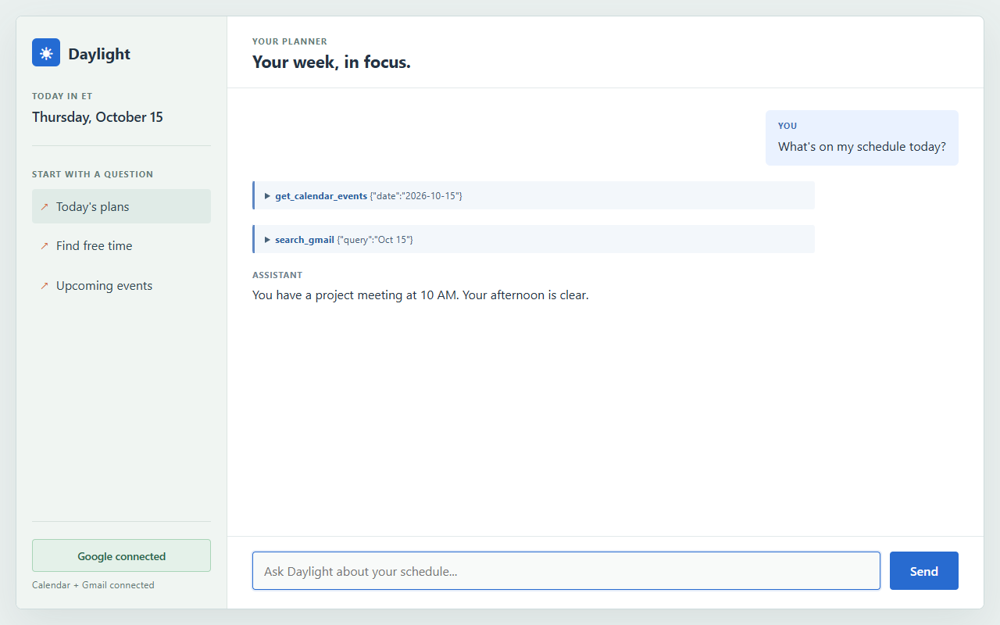
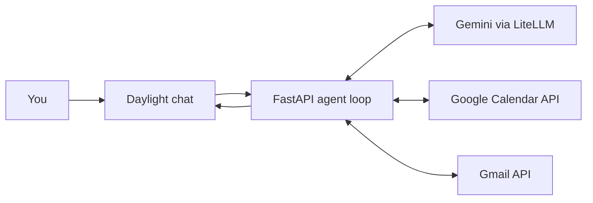

# Daylight

**Your calendar is only half the story. Daylight finds the rest.**

Classes are on your calendar. The interview invitation is in your inbox. The two hours you need to finish your project are somewhere in between. Daylight pulls those scattered pieces into one conversation, finds a time that makes sense, and helps turn an intention into an actual calendar event.

**Ask what is happening. Discover what you missed. Make room for what matters.**



*Illustrative UI preview with sample data.*

## Make time visible

Ask Daylight what is ahead, what might conflict, or where a new activity could fit. It can:

| Need | What Daylight does |
| --- | --- |
| **See the day, not just the grid** | Reads Google Calendar events for a day or date range and gives a clear schedule in Eastern Time. |
| **Uncover the hidden commitment** | Searches Gmail for relevant messages and uses their subjects and snippets to spot plans that may not be on the calendar. |
| **Find the opening** | Compares known commitments with a requested duration and suggests an available time to consider. |
| **Turn a plan into time** | Proposes an exact title and time, asks for confirmation, then creates the Google Calendar event. |
| **Take back a slot** | Looks up the event you mean, asks for confirmation, then deletes that specific event. |

For general schedule and free-time questions, Daylight is instructed to consult both Calendar and Gmail by default. You can also ask for calendar-only results. It keeps the conversation context for the session, so a follow-up like "Yes, add it" can refer to the time it just proposed.

### From "I should" to "it is scheduled"

```text
You:      Find me two hours for project work this Sunday.
Daylight: Your calendar is open after lunch, but I found an email about
          a workshop at 4:30 PM. I can add "Project Work" from 2:00
          to 4:00 PM ET. Should I put that on your calendar?
You:      Yes, add it.
Daylight: Done. "Project Work" is on your calendar.
```

*Example flow. Actual suggestions depend on the connected account's events and email search results.*

## An answer with evidence, not a guess

Daylight does not invent a schedule from a prompt. Gemini interprets the request and chooses a tool. The FastAPI backend calls Google, feeds the result back to Gemini, and repeats until it has an answer. Every tool call stays visible in an expandable trace, so you can see what informed the response.



### Four tools, one planning loop

| Tool | Inputs | What comes back |
| --- | --- | --- |
| `get_calendar_events` | `date` in `YYYY-MM-DD`; optional inclusive `end_date` in the same format | Event IDs, titles, and start/end times from the signed-in user's primary calendar. Date boundaries use Eastern Time. |
| `search_gmail` | A Gmail search query such as `interview`, `subject:meeting`, or `Oct 30` | Up to five matching messages with sender, subject, sent date, and snippet. Daylight checks the event date mentioned in the snippet rather than treating the sent date as the event date. |
| `create_calendar_event` | Event `summary`, `start`, and `end`; times are ISO 8601 with an Eastern Time offset | The created event's ID and title, after the user confirms the proposal. |
| `delete_calendar_event` | The `event_id` returned by calendar lookup | Confirmation that the selected event was deleted, after the user approves that deletion. |

Google sign-in requests Calendar event access and read-only Gmail access. Gmail is used to discover plans, not to send email. Calendar writes are intended to happen only after Daylight has shown the exact change and received a direct yes.

## Built with

- **Python + FastAPI** for the chat endpoint, Google OAuth flow, and tool execution.
- **Gemini 3.5 Flash-Lite via LiteLLM** for conversation and tool selection.
- **Google Calendar API + Gmail API** for account-specific schedule and message data.
- **Vanilla HTML, CSS, and JavaScript** for a responsive chat UI with quick prompts, connection status, and visible tool traces.

The code stays small: [`app.py`](app.py) contains the agent loop and web routes, [`tools.py`](tools.py) defines the four Google tools, and [`index.html`](index.html) contains the interface. Focused tests in [`tests/test_calendar_lookup.py`](tests/test_calendar_lookup.py) cover date ranges, invalid dates, and the Eastern Time daylight-saving change.

## Try asking

1. "What's on my schedule tomorrow? Check my calendar and email."
2. "Check my email and calendar. When do I have two free hours for a drive this week?"
3. "Find a free two-hour workout slot this Sunday and add it to my calendar."
4. "What commitments do I have between October 15 and October 31?"
5. "Delete my project work session on Friday." (Daylight should identify the event and ask before removing it.)

---

Built by **Arnav Jain**. Licensed under [MIT](LICENSE).
